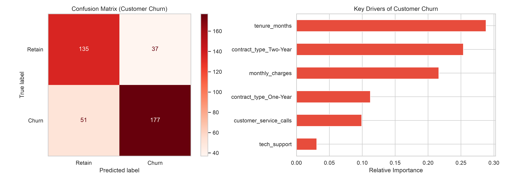

# Supervised Learning: Customer Churn Prediction

## Latar Belakang & Nilai Bisnis
Mendapatkan pelanggan baru (*Customer Acquisition*) memakan biaya 5 hingga 7 kali lebih mahal dibanding mempertahankan pelanggan lama (*Customer Retention*). Proyek ini bertujuan membangun model prediktif berbasis machine learning untuk mendeteksi pelanggan telekomunikasi yang berisiko tinggi berhenti berlangganan (*churn*), sehingga tim retensi dapat mengambil intervensi proaktif seperti penawaran khusus atau optimalisasi layanan.

---

## Fitur dan Metodologi
1. **Analisis Driver Churn:** Mengidentifikasi pengaruh tipe kontrak (*Month-to-month* vs *Annual*), masa berlangganan (*tenure*), tagihan bulanan (*monthly charges*), dan interaksi tiket keluhan (*customer service calls*).
2. **Penanganan Imbalanced Class:** Penyesuaian `class_weight='balanced'` pada algoritma Random Forest untuk memaksimalkan *Recall* pada pelanggan yang berpotensi churn.
3. **Actionable Thresholding:** Output probabilitas memungkinkan segmentasi pelanggan ke dalam *Risk Tiers* (Low, Medium, High).

---

## Hasil Evaluasi Model

### Rekomendasi Aksi Bisnis:
- **Pelanggan Kontrak Bulanan (Month-to-Month):** Memiliki risiko churn paling signifikan. Disarankan memberikan insentif diskon untuk migrasi ke kontrak tahunan.
- **Frekuensi Panggilan Customer Service > 3 Kali:** Menjadi sinyal frustrasi pelanggan (*critical churn trigger*). Perlu mekanisme rujukan otomatis langsung ke tim spesialis resolusi cepat.
- **Layanan Tech Support:** Pelanggan yang aktif memanfaatkan dukungan teknis menunjukkan rasio loyalitas yang jauh lebih tinggi.
