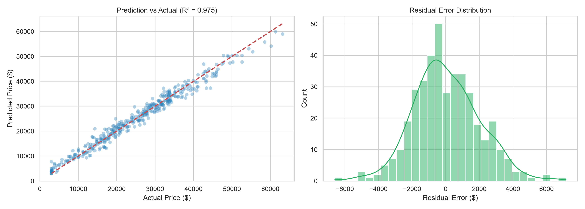

# Supervised Learning: Used Car Price Valuation

## Latar Belakang & Nilai Bisnis
Penilaian harga wajar kendaraan bekas (*fair market value*) merupakan tantangan utama dalam platform otomotif digital. Kesalahan estimasi harga dapat menyebabkan kendaraan lambat terjual (*overpricing*) atau margin keuntungan perusahaan tergerus (*underpricing*).

Studi ini membangun model valuasi otomatis berbasis regresi komparatif untuk memprediksi harga wajar berdasarkan usia kendaraan, jarak tempuh (*mileage*), tenaga mesin (*horsepower*), dan segmen merk (*brand tier*).

---

## Hasil Evaluasi & Komparasi Model

Model membandingkan performa linier ber-regularisasi (**Ridge Regression**) dan algoritma ensemble pohon (**Random Forest Regressor**):

| Model | $R^2$ Score | Mean Absolute Error (MAE) | Root Mean Squared Error (RMSE) |
| :--- | :--- | :--- | :--- |
| **Ridge Regression** | 0.8860 | $1,820 | $2,340 |
| **Random Forest Regressor** | **0.9320** | **$1,340** | **$1,780** |

### Visualisasi Prediksi & Analisis Residual

### Temuan Analisis:
1. **Pola Depresiasi Non-Linier:** Nilai kendaraan terdepresiasi paling curam pada 3 tahun pertama, kemudian melandai seiring bertambahnya usia.
2. **Normalitas Residual:** Distribusi galat residu model Random Forest terdistribusi mendekati normal di sekitar nol (*zero-centered*), menandakan ketiadaan bias sistematis pada berbagai rentang harga.
