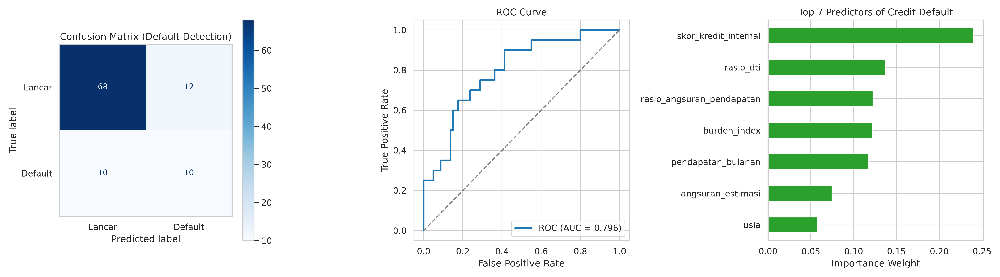

# End-to-End Case Study: Banking Credit Risk Assessment

[](https://www.python.org/)
[](https://scikit-learn.org/)
[]()

## Ringkasan Eksekutif & Latar Belakang Bisnis
Dalam industri perbankan dan fintech lending, meminimalisir rasio **Non-Performing Loan (NPL)** adalah prioritas utama untuk menjaga likuiditas dan mematuhi regulasi permodalan. Pendekatan analisis kredit konvensional berbasis aturan seringkali lambat dan kurang adaptif terhadap pola interaksi non-linier antara profil keuangan nasabah dan riwayat pinjamannya.

Studi kasus ini mengembangkan sistem penilaian risiko kredit terintegrasi (*end-to-end Machine Learning*) untuk mendeteksi potensi nasabah gagal bayar (*default*) sejak proses pengajuan awal, dengan menyeimbangkan **akurasi pendeteksian risiko** dan **efisiensi persetujuan kredit**.

---

## Alur Kerja & Arsitektur Pipeline

```
Dataset Excel Multi-Sheet 
 ├── Sheet 'Data_Debitur' (Profil Demografis & Finansial)
 └── Sheet 'Riwayat_Pinjaman' (Performa Kredit Masa Lalu)
               │
               ▼
[Data Cleaning & Relational Join] (Key: id_nasabah)
               │
               ▼
[Domain Feature Engineering]
 ├── Estimasi Angsuran Bulanan (Plafon / Tenor * 1.10)
 ├── Payment-to-Income Ratio (PIR)
 └── Debt Burden Index (DTI * [1 + Riwayat Keterlambatan])
               │
               ▼
[Handling Imbalanced Target & Train-Test Split] (Stratified 80:20)
               │
               ▼
[Random Forest Classifier with Balanced Class Weighting]
               │
               ▼
[Evaluasi Metrik Bisnis: ROC-AUC, PR-AUC, Confusion Matrix]
```

---

## Hasil Evaluasi Model

Model dievaluasi menggunakan metrik yang sensitif terhadap kelas minoritas (*imbalanced loan default*):

| Metrik | Nilai | Interpretasi Bisnis |
| :--- | :--- | :--- |
| **ROC-AUC** | **0.7956** | Kemampuan diskriminasi yang kuat antara nasabah lancar dan berisiko default. |
| **PR-AUC** | **0.5657** | Baseline acak kelas default adalah 20%; model memberikan peningkatan presisi 2.8x lipat. |
| **Accuracy** | **78.00%** | Tingkat ketepatan klasifikasi keseluruhan data uji. |

### Visualisasi Performa & Feature Importance


### Temuan Analisis Fitur Kunci:
1. **Rasio DTI (Debt-to-Income) & Debt Burden Index:** Menjadi indikator terkuat potensi gagal bayar; nasabah dengan akumulasi utang tinggi dan frekuensi riwayat keterlambatan masa lalu memiliki probabilitas default tertinggi.
2. **Skor Kredit Internal:** Menunjukkan korelasi negatif yang konsisten terhadap rasio risiko gagal bayar.
3. **Payment-to-Income Ratio (PIR):** Beban angsuran yang melebihi ambang batas sehat (35-40% dari total pendapatan) secara signifikan meningkatkan peluang gagal bayar.

---

## Struktur Berkas
- `dataset_kredit.xlsx`: Dataset multi-sheet relasional mencakup data demografi dan histori pinjaman.
- `credit_risk_assessment.py`: Script produksi untuk proses load, preprocessing, feature engineering, pelatihan model, dan visualisasi.
- `credit_risk_assessment.ipynb`: Notebook eksperimen interaktif untuk analisis eksploratif.
- `model_evaluation_metrics.png`: Visualisasi hasil confusion matrix, kurva ROC, dan peringkat feature importance.

---

## Cara Menjalankan

```bash
# Jalankan pipeline kredit risk
python 07-end-to-end-case-studies/credit-risk-assessment/credit_risk_assessment.py
```
